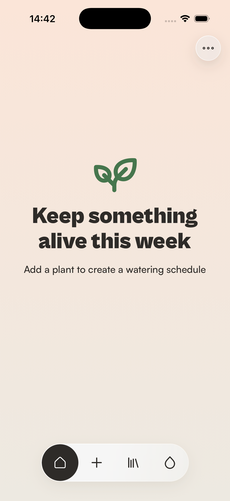
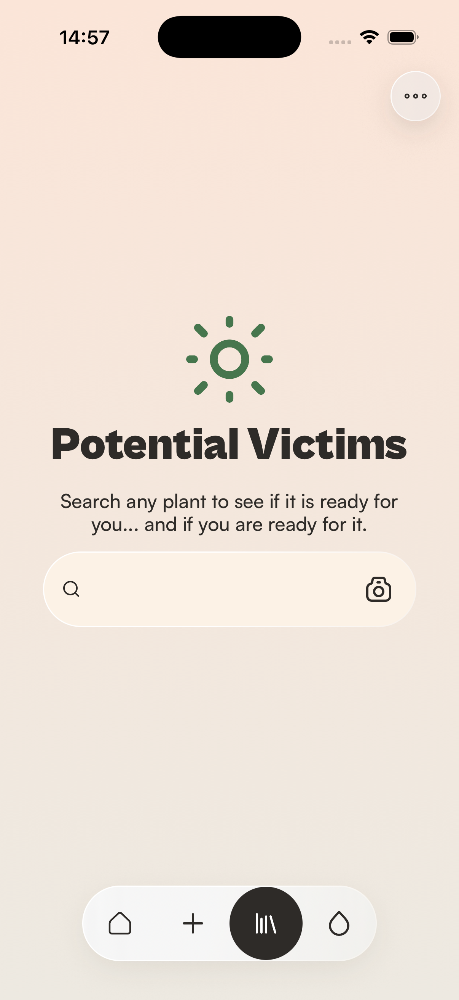
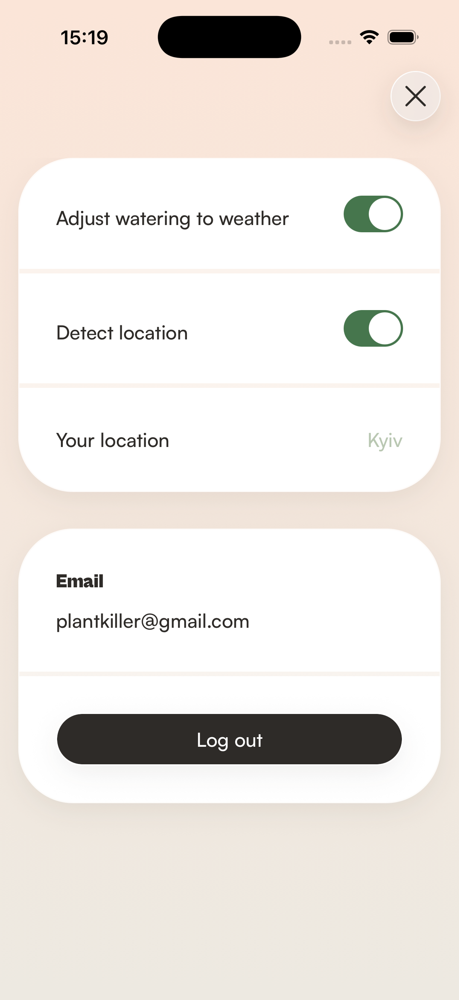

# Bloom

Watering reminders for people trying their best.

Bloom identifies a plant from a photo, keeps a watering schedule for the ones you own, and lets
you read up on anything before you buy it. This version adds weather-aware watering, remembers
your plants between launches, and rebuilds the screens so moving between them doesn't jump.

| Home | Plant wiki | Settings |
|---|---|---|
|  |  |  |

---

## Where this version started

Bloom already did a lot. Photos resolve to a real species through Pl@ntNet, care facts come from
Perenual, the descriptions are generated, and the photography is Unsplash's. Navigation is fully
typed end to end, the design system is twenty-odd components each in their own folder, and the
previous round of work cut the bundle and stopped the plant grid re-rendering on every keystroke.

Living with it turned up four things it got wrong.

**It forgot everything.** Close the app and every plant you'd added was gone, along with every
watering you'd logged. Since the schedule is calculated from the last entry in that history, the
app quietly reset its own core feature every time you quit it.

**Watering advice was a fixed number.** Each species carried an interval — fourteen days for a
Monstera — and used it in a damp October and a dry July alike, in Reykjavik and in Dubai.

**Switching tabs was an instant cut.** The bottom bar's indicator glided smoothly between icons
while the screen behind it snapped. And because the Library's empty state was laid out in a
different box from Home's, the two didn't line up.

**Searching the wiki felt broken.** Type "zz", wait, keep waiting. Nothing on screen said the app
had even registered the keystroke.

## What's new

### Watering that follows the weather

Bloom reads the daily forecast for where you are and moves each plant's watering date to match.
The figure it uses is reference evapotranspiration — a single millimetres-per-day number that
folds together temperature, humidity, wind and sunlight to describe how fast water actually
leaves soil. A fourteen-day plant becomes a ten-day plant in Dubai and a twenty-day plant in
Reykjavik.

That measure catches things a temperature rule would miss. Singapore is hotter than Madrid and
gets the *gentler* schedule, because ninety percent humidity slows evaporation to a crawl.

| City | Mean ET₀ | Interval for a 14-day plant |
|---|---|---|
| Dubai | 5.89 mm/day | 10 days |
| Delhi | 4.56 | 11 days |
| Madrid | 4.41 | 12 days |
| Singapore | 3.75 | 13 days |
| London | 2.33 | 16 days |
| Kyiv | 1.96 | 17 days |
| Reykjavik | 1.12 | 20 days |

*Live Open-Meteo readings for one day; the numbers move with the seasons.*

The adjustment is deliberately bounded. A species' interval is horticultural knowledge and an
outdoor measurement is only a proxy for what a pot on your windowsill experiences, so the weather
nudges that interval rather than overruling it. It's also why this is a switch you can turn off:
if your home is climate controlled, the weather outside genuinely doesn't apply, and Bloom then
behaves exactly as it did before.

Bloom works out where you are from your phone's time zone, which needs no location permission and
no prompt — the same trick iOS's own Date & Time settings use. Turn detection off and you can pick
any city instead; the one you already had stays put until you change it.

### Your plants stay yours

Plants, watering history, favourites and settings all survive closing the app. Adding a plant and
watering it are the two things in Bloom nobody can reconstruct from anywhere else, and they now
persist.

If a saved file is ever unreadable, Bloom starts anyway and loses only that part. Losing your
favourites is recoverable; an app that won't open isn't.

### Screens that hold still

Tabs cross-fade instead of cutting. For that to read as one screen becoming another, the content
has to stay where it is — so Home, Water and the plant wiki now share one empty-state component
and land it on the same pixel on all three.

The wiki's search bar moved to the bottom, within thumb reach, sitting under the subtitle as part
of the same block and rising above the keyboard when you type. That freed the top-right corner for
the settings button every other tab already had.

### Search that answers immediately

Bloom ships twelve curated species, and they're now searched on your phone before any request
goes out — type "zz" and ZZ plant appears with no network round trip at all, and opens instantly
too. Repeated searches are cached. Only a genuinely new plant waits on Perenual, and that wait now
shows a spinner instead of an empty screen.

This was measured rather than guessed: Perenual's response time is one to three seconds depending
on the hour, all of it server-side. Nothing in the app can make it faster, so the work went into
not waiting on it.

## How state is organised, and why it's split

Three kinds of state, three homes. The split is about the shape of the data, not about using two
libraries for their own sake.

| State | Where | Why there |
|---|---|---|
| Plants you own, detections, species cache, search history | **Context** (`PlantDataProvider`) | Read and written from nine unrelated screens. Passing it as props would thread it through every intermediate navigator |
| Favourites, weather switches, chosen city | **Redux** (`favoritesSlice`, `settingsSlice`) | Small, serialisable, and read from places with no parent/child relationship — the heart on a species page, the tab bar, the favourites list, the settings panel |
| Forecast data | **Context** (`WeatherProvider`) | Asynchronous, with loading and error states, cached by coordinates and deduplicated in flight. A thunk plus three status fields would be more machinery for less clarity |
| Search text, focus, in-flight results | `useState` | Nothing outside the screen reads it |

Redux earns its place where state is small, serialisable and shared between unrelated components —
which is also what makes it trivial to persist, since the listener that saves it only has to watch
the handful of actions that change it. Context earns its place where the data is large, holds
functions, and is genuinely owned by one feature.

One rule holds across both: every screen that asks "does this plant need water?" goes through a
single hook. The tab bar's badge and the Water screen's list can't disagree, because they compute
it the same way.

## How the code is organised

```
src/
├── components/ui/        design system — one folder per component, each with an index.ts
├── features/
│   ├── plants/           plant domain: provider, species resolution, schedule maths
│   ├── settings/         settings panel and its rows
│   ├── watering/         watering cards, slider, schedule display
│   └── weather/          forecast provider, location detection, the ET₀ adjustment
├── navigation/           navigators, typed route params, tab bar
├── screens/              one file per screen, composed from the above
├── services/             every network call — Perenual, Pl@ntNet, DeepSeek, Unsplash, Open-Meteo
├── store/                Redux slices, persistence
└── theme/                colour, spacing, radii, typography tokens
```

The boundaries that make it navigable:

- **Every HTTP call lives in `services/`.** Five external APIs, each behind a module with its own
  typed error. No screen or component knows a URL.
- **One component per folder, exported through a barrel.** Imports reach for `@components/ui/Button`,
  never a file path inside it — enforced by lint, not by convention.
- **Colour only exists in `theme/`.** Not one hex value or `rgba()` anywhere else in `src` — the
  single match outside it is a comment explaining why two tokens resolve to the same white.
- **State logic lives outside screens.** A screen composes; the provider and the slices decide.
- **Domain maths is its own module with its own tests.** `wateringAdjustment`, `schedule`,
  `difficulty` and `speciesSearch` are pure functions, tested without rendering anything.

236 tests across 26 suites, with the type-checker and linter clean.

## Running it

```bash
npm install
npm run ios      # or: npm run android
```

Bloom needs API keys for Perenual, Pl@ntNet, DeepSeek and Unsplash — copy `.env.example` to `.env`
and fill them in. Open-Meteo, which powers the weather feature, needs no key at all.

```bash
npm test             # 236 tests
npm run lint
npx tsc --noEmit
```

## Earlier work

| Area | What it covers |
|---|---|
| Design system |  22 components, each in its own folder |
| Navigation |  typed params, stack / tabs / drawer |
| Plant identification |  photo → Pl@ntNet → Perenual → generated care copy |
| Favourites |  Redux, filtered by care difficulty |
| Performance |  sliding indicators, memoised grids, smaller bundle |
