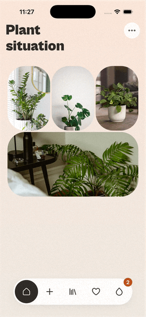

# Bloom

Bloom is a watering app for people who keep forgetting to water their plants. You take a photo,
Bloom tells you what the plant is and when it needs water, and shows which plants are thirsty
today.

What you can do in it:
- identify a plant from a photo and add it to your plants
- see which plants need water today and log a watering
- browse plants and read about them before you buy one
- save plants you like to favourites

What this version adds, in three areas:
- Location-based watering schedule
- Plant suggestions in the Library
- UX improvements: tab fade, dark mode

# Location-based watering schedule
Before, every plant had a fixed interval. A Monstera got water every 14 days in a wet October
and a hot July alike, in Kyiv and in Dubai.

Now Bloom reads the forecast for where you are (Open-Meteo) and moves each plant's next watering
date. It uses evapotranspiration, a single number for how fast water leaves soil that takes in
temperature, humidity, wind and sun. Dry, hot weather brings the date closer, cool and damp
weather pushes it back. The change is capped, so the weather adjusts the plant's own interval
instead of replacing it.

Your location comes from the phone's GPS, asked once right after sign-in. If you say no, Bloom
uses the city from your time zone. You can also turn detection off and pick any city by hand, or
turn the whole feature off if your home is climate controlled.




# Plant suggestions in the Library

The Library used to be an empty page with a search bar. Now it shows popular indoor plants,
ordered by how well they'd do where you live. Bloom looks at how short your winter days are, how
humid it is and how cold it gets (from Open-Meteo's weather history), so in Kyiv you get plants
that cope with low light, and in Dubai ones that like sun. Without a location you get the ten
most popular.

Chips on top filter the grid: All, Unkillable, Moody, Pet-safe, Sunbathers and Shady. The same
chips are used in Favourites. Tapping a plant opens its page: the Library passes the plant's id as
a typed route parameter, and the page loads everything else from it.


# UX improvements

### Tab fade

Switching tabs used to be an instant cut. Now screens cross-fade, and the empty states on Home
and Water sit in exactly the same place, so the fade looks like one screen turning into another.


### Dark mode

Bloom follows the phone's light or dark setting by default. In settings you can turn that off and
pick dark or light yourself. All colours come from one theme, so every screen and component
switches together.


# State management

Bloom uses both Context and Redux, each where it fits better.

| State | Where | Why |
|---|---|---|
| Your plants, watering history, plant search history | Context (`PlantDataProvider`) | Belongs to the plants feature, comes with functions that call the APIs, and is used by many screens |
| Weather forecast | Context (`WeatherProvider`) | Loaded from the network with loading and error states, cached by location |
| Current theme | Context (`ThemeProvider`) | Read by every component and changes rarely, the usual case for Context |
| Favourites | Redux (`favoritesSlice`) | Small and shared between screens that have nothing to do with each other |
| Settings: weather switches, city, recent cities, theme choice | Redux (`settingsSlice`) | Same as favourites, and easy to save: a listener writes the slice to storage when it changes |
| Saving between launches | AsyncStorage | Your plants and watering history are saved by `PlantDataProvider`; favourites and settings by a Redux listener that writes the two slices when they change; plants Bloom has looked up and written about are kept too, so they open instantly next time |
| Search text, focus, open modals | `useState` | Only the screen itself needs it |

All the "does this plant need water?" logic goes through one hook, so the tab bar badge and the
Water screen always agree.

# Code structure

```
src/
├── components/ui/   reusable components, one folder per component
├── features/        plants, watering, weather, settings: logic and feature components
├── navigation/      navigators, typed route params, tab bar
├── screens/         one file per screen
├── services/        all network calls: Perenual, Pl@ntNet, DeepSeek, Unsplash, Open-Meteo
├── store/           Redux slices and saving to storage
└── theme/           colours, spacing, type, light and dark themes
```

- Every component has its own folder with an `index.ts`, and is imported through it.
- New in this version: `Toggle`, `SearchOverlay` (one search for plants and cities), `EmptyState`,
  `Photo`, `Touchable`; `Tabs`, `GlassView`, `Badge` and `ScreenLayout` were extended.
- Screens only put things together. Data and state logic live in features and the store.
- No screen or component calls an API directly, everything goes through `services/`.
- Colours exist only in `theme/`, and the linter fails on a colour anywhere else.

# Running it

```bash
npm install
cp .env.example .env   # add keys for Perenual, Pl@ntNet, DeepSeek and Unsplash
npm run ios            # or: npm run android
```

Open-Meteo needs no key.

```bash
npm test               # 366 tests
npm run lint
npx tsc --noEmit
```
